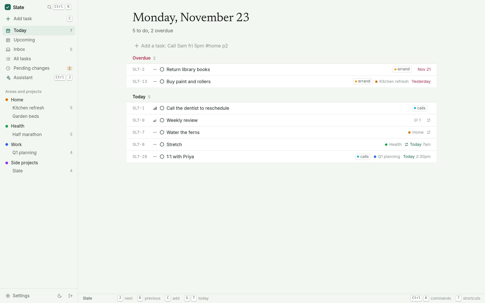
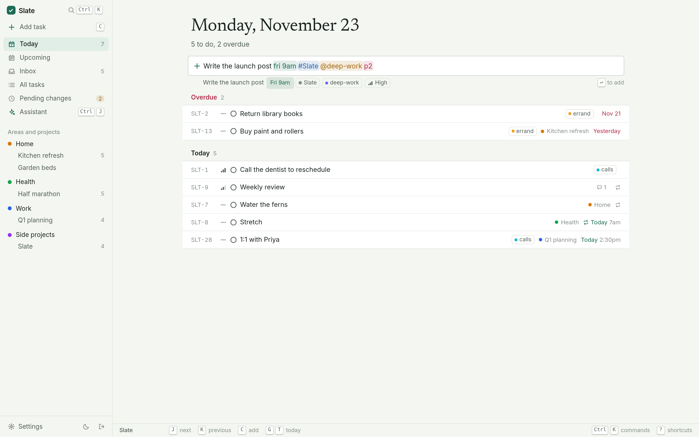
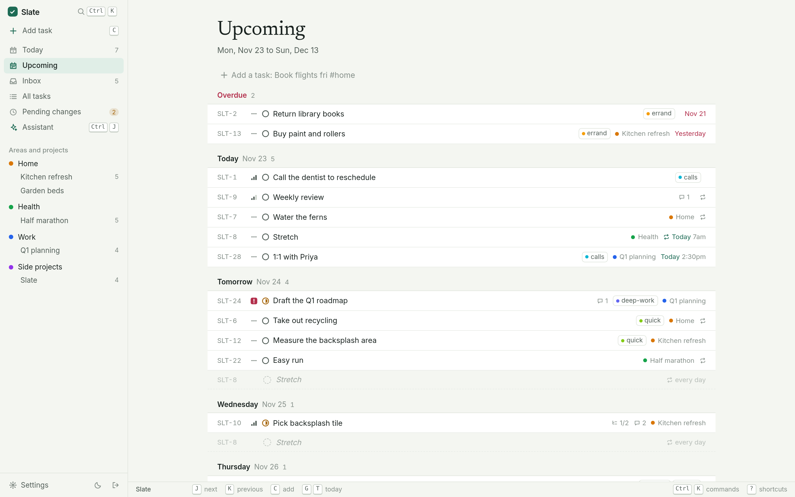
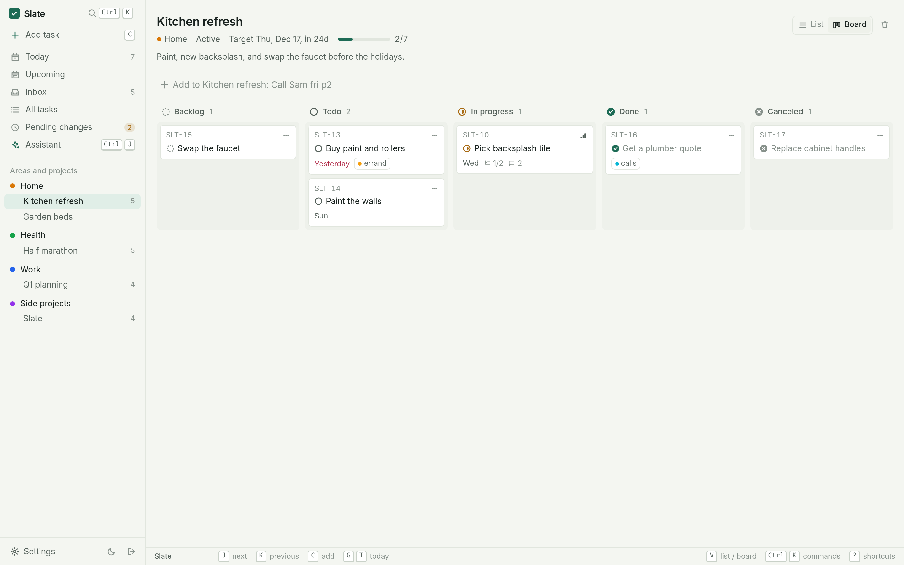
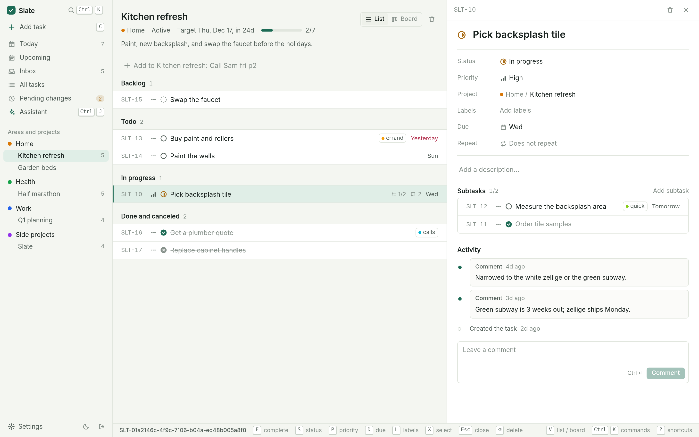
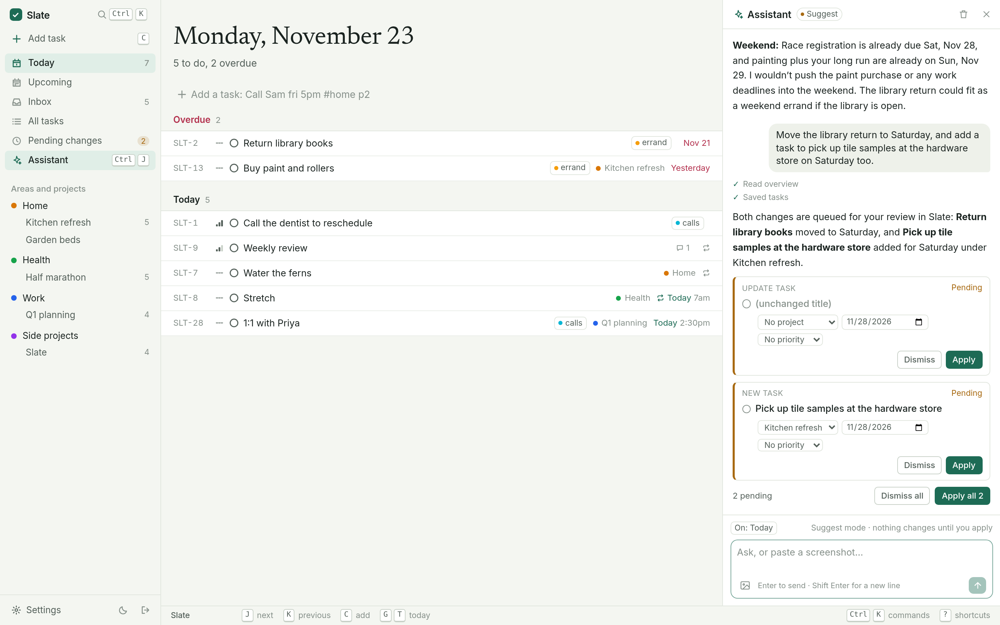
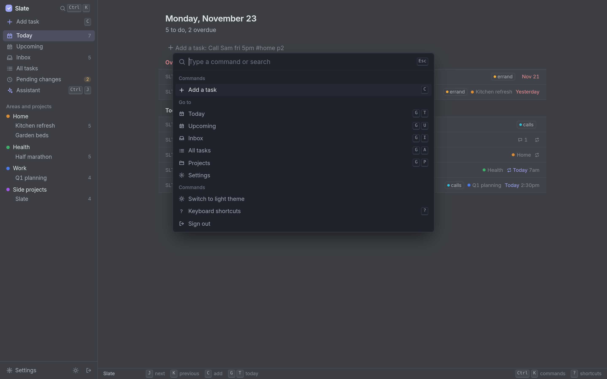

# slate

A fast, keyboard-first personal task manager that replaces Linear and Todoist.

**[Open slate at slate.mattjmcnaughton.com →](https://slate.mattjmcnaughton.com)**

Signing in to the hosted app is limited to an allowlist of email addresses. To try slate yourself, [run it locally](#try-it-locally): it comes up already signed in, with sample data.



## What it does

- **Type tasks the way you think.** `Write the launch post fri 9am #Slate @deep-work p2` sets the due date, project, label, and priority as you type.
- **Today and Upcoming** show overdue work and the next three weeks, including future repeats of recurring tasks.
- **Projects with a list or a board**, grouped into areas, with target dates, progress, subtasks, and comments.
- **Recurring tasks** with Todoist-style rules such as `every tue` or `every! 3 days`.
- **Keyboard everywhere**: `C` to add, `J`/`K` to move, `G T` for Today, `Ctrl+K` for the command palette, `?` for every shortcut. Light and dark themes.
- **An assistant that drafts, you decide.** Ask the sidebar assistant (`Ctrl+J`) to triage, reschedule, or turn a screenshot into tasks. Its writes land as Pending changes you apply or dismiss. AI clients such as Claude Code connect to the same tools over MCP at `/mcp`.
- **Bring your data**: a bulk import API (`POST /api/import`) moves areas, projects, labels, tasks, and comments over from Linear and Todoist.

## Screenshots

**Quick add** turns one line of text into a scheduled, labeled task.



**Upcoming** groups the next three weeks by day, with upcoming repeats shown faintly.



**Projects** switch between a list and a board.



**Task detail** holds status, priority, subtasks, and comments.



**The assistant** answers questions about your tasks and drafts changes as Pending changes, which you edit, apply, or dismiss.



**The command palette** (`Ctrl+K`) reaches every view and command, here in the dark theme.



## Try it locally

You need Python 3.12+, [uv](https://docs.astral.sh/uv/), [just](https://just.systems/), Node.js 20+, and [pnpm](https://pnpm.io/).

```sh
git clone https://github.com/mattjmcnaughton/slate.git
cd slate
uv sync --dev
(cd src/slate/web/frontend && pnpm install)
just dev
```

Open the URL the frontend dev server prints (usually http://localhost:5173). `just dev` uses in-memory storage, signs you in as a local dev user, and loads sample data, so nothing needs configuring. Use `just dev-be-sqlite` instead of `just dev-be` to keep data in `./data.db` between restarts. The assistant needs `OPENROUTER_API_KEY` set (see `.env.example`); everything else works without it.

The API runs at http://localhost:8000 (interactive docs at `/docs`), and the frontend dev server proxies `/api` to it. Run them separately with `just dev-be` and `just dev-fe`.

## Development

```sh
# Check formatting and linting (backend + frontend)
just fmt
just lint

# Fix formatting and linting
just fmt-fix
just lint-fix

# Run type checker
just typecheck

# Backend-only or frontend-only variants
just fmt-be
just lint-fe
```

## Testing

```sh
# Run unit tests (backend + frontend)
just test-unit

# Run all tests
just test-all

# Full pre-push check
just gate
```

## Deployment

```sh
# Build Docker image
docker build -t slate .

# Run container
docker run -p 8000:8000 slate
```

## Frontend

The React frontend lives in `src/slate/web/frontend/`. Run `just storybook` there to browse every screen, overlay, and component in light and dark themes, including empty and loading states. Storybook runs against an in-browser mock API, so it needs no backend.

## Architecture

See [docs/architecture.md](docs/architecture.md) for project structure and design decisions.

## API

See [docs/api.md](docs/api.md) for endpoint reference.

## License

[MIT](LICENSE)
